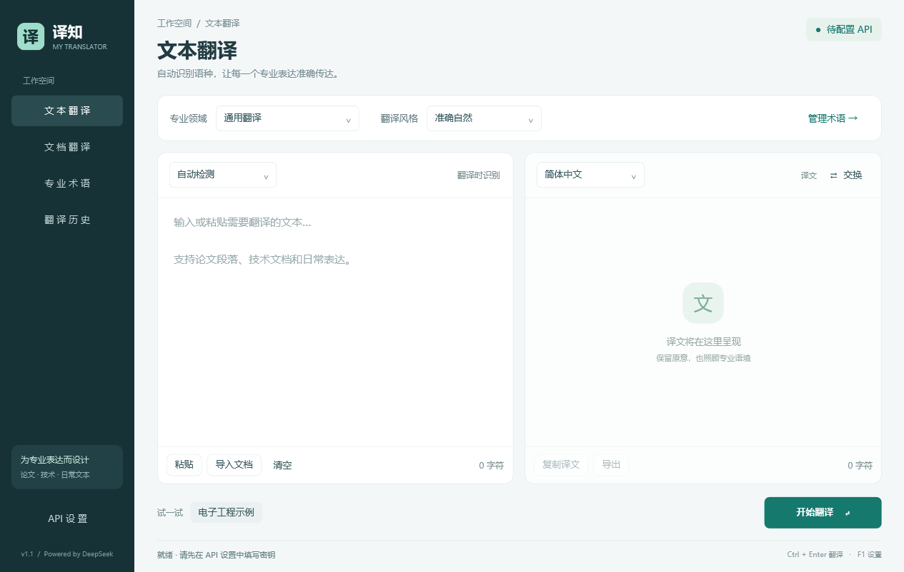
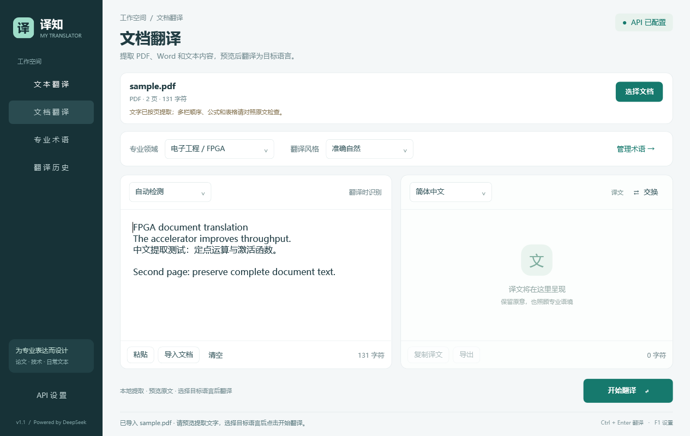
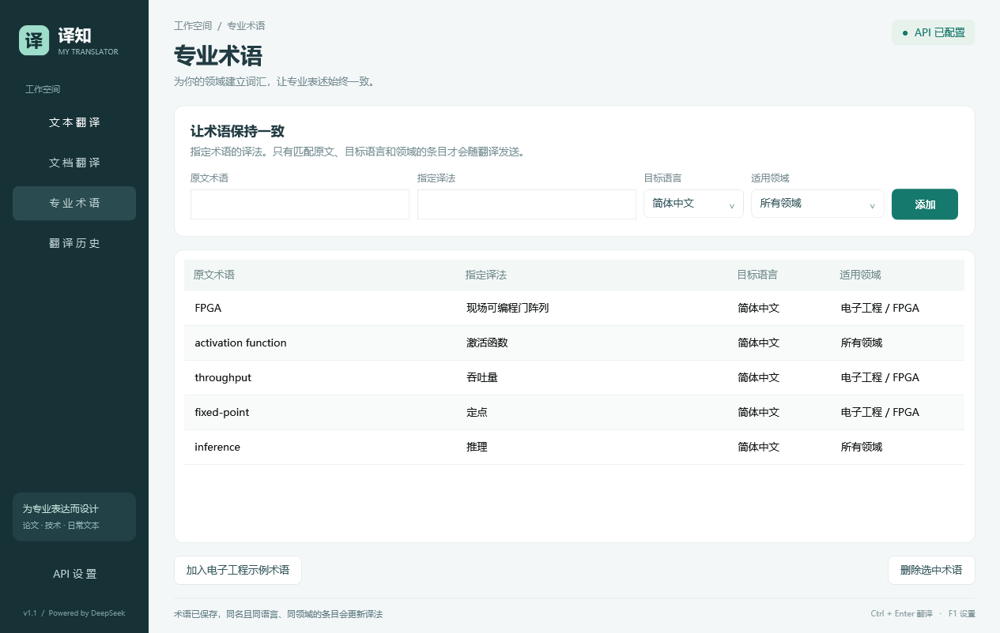

# 译知 · My Translator

一个可直接运行的 Windows 原生桌面翻译工具，使用你自己的 DeepSeek API Key。自动识别源语言，翻译到所选目标语言，支持专业领域和自定义术语。

使用 C# / WPF 开发，支持文本翻译与本地文档文字提取，适用于日常文本、论文段落和技术文档。便携版已包含 PDF 解析依赖，无需安装 Python 或 Microsoft Word。

[下载 Windows 便携版](https://github.com/duyu07057-lang/my-translator/releases/latest) · [报告问题](https://github.com/duyu07057-lang/my-translator/issues)



## 开始使用

1. 在 [Releases](https://github.com/duyu07057-lang/my-translator/releases/latest) 下载并解压便携版，双击包内 `MyTranslator.exe` 或 `Start.cmd`。
2. 进入左下角「API 设置」，填写自己的 DeepSeek API Key，然后点击「保存设置」。密钥不需要发给开发者或填写到源码中。
3. 返回「文本翻译」，选择目标语言、专业领域和翻译风格。
4. 粘贴文本，点击「开始翻译」，或按 **Ctrl + Enter**。
5. 译文出现后，可复制或导出为 TXT / Markdown / Word (.docx)。

获取密钥：[DeepSeek 官方平台](https://platform.deepseek.com/api_keys)。API 调用需要联网，并由 DeepSeek 按账户实际用量计费；本软件不提供免费额度。界面中「API 已配置」只代表填写了密钥，首次实际翻译时才验证密钥和网络。

运行环境：Windows 10 / 11，安装 [.NET Framework 4.8](https://dotnet.microsoft.com/download/dotnet-framework/net48)。EXE 为便携版，无需安装 Python、Node.js 或开发 SDK。请完整解压，保留 EXE 同目录的配置和全部 DLL，不能只复制 EXE。

新版便携包文件名为 `MyTranslator-Windows-v1.1.0.zip`。也可以按下方步骤从源码构建，构建后直接运行 `dist\MyTranslator.exe`，或双击源码根目录中的 `启动翻译软件.cmd`。

## 已有功能

| 功能 | 用法 |
| --- | --- |
| 自动检测语言 | 默认自动检测，也可手动选择源语言；识别结果显示在原文上方 |
| 多种目标语言 | 简体中文、繁體中文、英语、日语、韩语、法语、德语、西班牙语、俄语、葡萄牙语、阿拉伯语 |
| 专业领域 | 通用翻译、学术论文、电子工程 / FPGA、计算机 / 人工智能、医学 / 生物、法律、金融 / 商务 |
| 翻译风格 | 准确自然、严谨学术、简洁易懂 |
| 专业术语表 | 添加原文术语、指定译法、目标语言、适用领域；支持更新和删除 |
| 长文本 | 一次最多 100,000 个 UTF-16 字符；约每 2,400 字符分段，尽量沿换行或空白拆分 |
| 停止翻译 | 立即取消等待，保留已经完成的段落，并显示「部分译文」 |
| 文档翻译 | 导入或拖入 PDF、Word (.docx)、Markdown、TXT，本地提取后预览、修改并翻译 |
| 文本编码 | TXT / Markdown 支持 UTF-8、带 BOM 的 Unicode 和 GB18030 中文文本 |
| 复制 / 导出 | 复制译文、导出 TXT / Markdown / Word (.docx)；不保留原文档版式，部分译文会明确标记 |
| 反向翻译 | 完成一次翻译后点击「交换」，再点击开始翻译 |
| 翻译历史 | 最多 50 条，只记录完整成功的翻译，支持重新打开和清空 |
| 错误提示 | 区分密钥无效、余额不足、限流、模型错误、连接异常、超时和输出截断 |

快捷键：**Ctrl + Enter** 翻译，**Ctrl + Shift + C** 复制译文，**F1** 打开设置。

## 文档翻译

1. 点击左侧「文档翻译」，再点击「选择文档」，或把一份文档直接拖入窗口。
2. 文档在本地解析，提取结果出现在原文区。此步骤不需要 API Key，不会自动发送内容。
3. 预览并按需修改提取的文字，检查页面遗漏、表格顺序和专业术语。
4. 选择目标语言、专业领域和翻译风格，点击「开始翻译」。软件通过已有的 DeepSeek 分段翻译流程处理文字。
5. 点击「导出」，可保存新的 TXT、Markdown 或 Word 文档。原文档不会被修改，软件会阻止直接覆盖当前导入的文件。



| 输入格式 | 提取内容与限制 |
| --- | --- |
| PDF | 提取文字层，显示页数；没有文字的页面会明确提示，便于发现混合扫描页面。纯扫描或图片型 PDF 请先 OCR |
| Word (.docx) | 提取正文、表格和正文关联的页眉、页脚、脚注、尾注；忽略已删除修订，不读取图片中的文字 |
| Markdown (.md / .markdown) | 读取原始 Markdown 文本，保留标记与代码，随后交给翻译模型处理 |
| TXT | 读取文本；自动处理常用 Unicode 编码，并尝试兼容 GB18030 中文编码 |
| 旧版 Word (.doc) | 暂不支持直接读取；请使用 Word 或 WPS 另存为 .docx 后导入 |

单文件最多 50 MB，PDF 最多 500 页，提取后的文字最多 100,000 个 UTF-16 字符。超出限制会拒绝导入并提示拆分，不会静默截断。提取过程可以取消，导入失败或取消时会保留原有编辑内容。

此功能翻译提取出的文字，不复刻 PDF / Word 的页面版式。多栏阅读顺序、复杂表格、公式和图片内容需要对照原文；DOCX 中的公式仅以文字片段提取。导出的 Word 是新的文字文档，当前不支持导出 PDF。

## 专业文本怎样用

以 FPGA 论文段落为例：

1. 目标语言选择「简体中文」。
2. 专业领域选择「电子工程 / FPGA」，文风选择「严谨学术」。
3. 在「专业术语」中点击「加入电子工程示例术语」，或加入自己课题组习惯的译法，例如 `activation function → 激活函数`。
4. 翻译后检查公式、数值、单位、缩写和关键术语。

| 原文术语 | 指定译法 | 目标语言 | 适用领域 |
| --- | --- | --- | --- |
| FPGA | 现场可编程门阵列 | 简体中文 | 电子工程 / FPGA |
| activation function | 激活函数 | 简体中文 | 所有领域 |
| throughput | 吞吐量 | 简体中文 | 电子工程 / FPGA |
| fixed-point | 定点 | 简体中文 | 电子工程 / FPGA |



术语匹配不区分大小写，按原文包含关系查找；只有目标语言一致，且领域一致或设为「所有领域」的条目才会发送。相同原文术语、语言和领域的条目再次添加时会更新。术语表最多 500 条，每项最多 200 字符。术语是给模型的翻译约束，不能保证每次都完全遵守。

软件通过领域提示和术语表改善专业表达，没有额外训练专用模型，也不包含专业知识库。语种识别同样由模型完成，短文本或混合语言可能判断不准。长文本的各段独立翻译，跨段上下文、代码块、公式和 Markdown 格式可能受影响；关键文档需要人工复核。

## 密钥和本地数据

- 请求固定发送到 `https://api.deepseek.com/chat/completions`，没有中间转发服务器。
- 文档解析在本地进行，原始 PDF / DOCX 文件及其本地路径不会上传；点击翻译后，只提交原文区中的提取文字及翻译设置。开启历史保存后，文档提取文字和译文也会按相同规则存入本地历史。
- 仅在点击「开始翻译」或触发对应快捷键时发送原文、语言、领域、风格及匹配术语；没有后台剪贴板监听，也没有遥测。
- API Key 默认只保留在当前会话。勾选「在这台电脑上保存密钥」后，使用 Windows DPAPI 的 `CurrentUser` 模式加密保存，不写入明文密钥。它不能防止当前 Windows 账户下的其他程序访问或解密。
- 也可以由进程环境变量 `DEEPSEEK_API_KEY` 提供密钥；仅在没有可用保存密钥时读取。
- 翻译历史默认只保留在本次会话。开启「保存翻译历史」并保存设置后，会把原文和译文以明文写入当前用户目录。
- 关闭历史保存并点击「保存设置」，会删除磁盘上的历史文件；当前会话的历史仍可查看。
- 本地目录：`%LOCALAPPDATA%\MyTranslator\`。`settings.json` 保存偏好、术语表和可选的加密密钥，`history.json` 保存可选的翻译历史。需要在不同 Windows 用户之间迁移时，重新填写 API Key。
- EXE 没有购买代码签名证书。Windows 在首次运行从网络取得的副本时，可能显示未知发布者提示。
- 仓库排除了本地配置、历史、环境变量文件、构建目录和测试产物；密钥只需在软件内填写，不要提交至 GitHub。

## 接口约定

默认模型为 `deepseek-flash`，设置页还可选择 `deepseek-v4-pro` 或手动填写官方支持的模型名称。模型名称根据 2026-10-11 查阅的官方文档设置，后续可在界面中更新。

每段使用一次非流式 Chat Completions 请求，在同一次请求中完成语种识别和翻译。启用 JSON 输出，关闭思考模式；输出上限为 8,192 tokens，温度为 0.2。程序校验输出字段；如果服务报告输出截断，不会把该段当作完整译文。

单次请求超时为 120 秒。HTTP 429 和 5xx 最多自动重试两次，重试等待可取消；已完成段落不会重新请求。其他错误不自动重试。取消可能发生在服务端已收到请求之后，因此不保证取消操作免除服务端已经产生的费用。

官方参考：[首次调用](https://api-docs.deepseek.com/)、[Chat Completions](https://api-docs.deepseek.com/api/create-chat-completion/)、[JSON 输出](https://api-docs.deepseek.com/guides/json_mode/)。

## 从源码构建

在装有 .NET Framework 4.8 的 Windows 电脑上打开 PowerShell：

```powershell
git clone https://github.com/duyu07057-lang/my-translator.git
cd my-translator
powershell.exe -NoProfile -ExecutionPolicy Bypass -File .\build.ps1
```

程序输出至 `dist\MyTranslator.exe`。如果当前 PowerShell 允许执行本地脚本，也可以直接运行：

```powershell
.\build.ps1
```

若本机的脚本执行策略阻止运行，可在单次进程中运行：

```powershell
powershell.exe -NoProfile -ExecutionPolicy Bypass -File .\build.ps1
```

构建直接使用 Windows 自带的 .NET Framework C# 编译器，无需安装 NuGet CLI、npm 或 .NET SDK。首次构建会通过 `restore-dependencies.ps1` 从 NuGet 官方源下载固定版本的 PdfPig 及 .NET 依赖，校验 `dependencies.lock.json` 中的 SHA-256，再复制所需 DLL。后续可使用本地 `packages/` 缓存离线构建。程序不需要管理员权限，构建不修改系统配置。

构建完成后运行 `.\package.ps1`，可以重新生成包含 EXE、依赖 DLL、运行配置、启动脚本、使用说明、界面截图和第三方许可证的便携 ZIP。包输出至 `release\MyTranslator-Windows-v1.1.0.zip`。第三方组件见 [THIRD_PARTY_NOTICES.md](THIRD_PARTY_NOTICES.md)。

```text
src/
  MainWindow.xaml    原生 WPF 界面及样式
  MainWindow.cs      页面交互、文件操作、翻译流程
  Core.cs            文本拆分、术语匹配、DeepSeek 请求和响应校验
  Settings.cs        DPAPI 密钥保存、偏好和历史记录
  Documents.cs       PDF / DOCX / 文本提取与文字译文导出
  Program.cs         应用入口
tests/
  Tests.cs           模拟 HTTP 和实际 WPF 窗口测试
  DocumentTests.cs   文档提取与导出测试
  fixtures/          人工编写的 PDF / DOCX 示例
build.ps1            构建和测试入口
restore-dependencies.ps1  固定依赖下载与校验
dependencies.lock.json    依赖版本与 SHA-256
dist/
  MyTranslator.exe   可运行程序
```

## 验证

```powershell
.\build.ps1 -Test
```

当前版本已在本地通过 **118 项检查**。除已有的翻译、术语、认证、重试、取消、DPAPI 和历史检查外，还覆盖 PDF 中英文与多页提取、混合扫描页面提醒、加密和损坏文档、Word 表格和注释文字、文档提取取消、失败保留原文、离线预览，以及四种文档导入后调用模拟 API 完成翻译的实际窗口流程。

测试中的 PDF / DOCX 样本是人工编写的示例。`tests/fixtures/generate.py` 可重新生成这些样本，可选依赖 ReportLab、python-docx、pypdf；运行软件和 C# 测试无需安装这些工具。导出的 Word 还使用 python-docx 独立读取验证。

测试不会连接真实 DeepSeek API，也不需要真实密钥。结果和实际窗口渲染图位于 `tests\artifacts\`。测试截图中的译文由模拟服务返回，不能作为真实模型的翻译质量证据。尚未使用真实账户验证联网翻译；首次真实验证需要用户在界面中填写有效密钥。

README 中的界面截图来自自动化桌面测试，使用测试配置和示例术语，不包含真实密钥或个人翻译历史。

## 当前范围与反馈

当前版本支持文本及 PDF / DOCX / Markdown / TXT 文档的文字翻译，不支持图片 OCR、旧版 .doc 直接读取、原文档版式还原或划词翻译。欢迎通过 [Issues](https://github.com/duyu07057-lang/my-translator/issues) 反馈问题或提出需求，请提供 Windows 版本、复现步骤和脱敏后的示例文本，不要上传 API Key 或机密原文。
